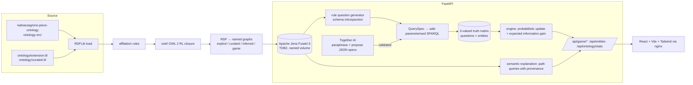

# Architecture

## Game loop
1. At start-up the backend introspects the graph, generates ~200 rule questions (relation→target with support ≥ `MIN_SUPPORT`=8 (15 for residence/origin), organisation-typed affiliations only, all distinguishing facts for the 9 ships, OWL-inferred class questions, fruit-type paths, height/age quantile thresholds) and evaluates each `QuerySpec` once against Fuseki → truth matrix `T[q,e] ∈ {1,0,-1}`.
2. Prior over all 1,653 entities: **popularity-weighted by default** (`PRIOR=popularity`, `w ∝ (1+degree)^α`, α=`POPULARITY_ALPHA`=1.5; `PRIOR=uniform` restores the spec's uniform MVP prior). Popularity = graph degree computed at ingestion (`popularity` node property; fruits/ships inherit their user's/owner's degree) - top: Luffy, Robin, Zoro, Sanji, Nami. Each answer multiplies the candidate weights by `P(answer | truth)` (5×3 likelihood matrix, `engine.DEFAULT_LIKELIHOOD`; UNKNOWN is a mixture of TRUE/FALSE rows; "don't know" is neutral).
3. (Default `adaptive` policy, see docs/POLICY.md: multi-objective score over information gain, coverage, semantic novelty, topic diversity, specificity, repetition and complexity, sampled from the top-5 with a seeded softmax; phases derived from entropy/confidence. The old rule below is the `deterministic` policy.) Next question = argmax of `IG × coverage^γ`, where `IG = H(w) − Σ_a P(a)·H(w|a)` is exact under the answer model and `coverage = 1 − P(unknown)`. Asked questions are excluded; after a "don't know" the whole question family is excluded; every earlier question of the same family multiplies the score by `FAMILY_DECAY` (0.7) so the game does not hammer one kind of question.
4. Guess when top probability ≥ 0.80 (after ≥3 questions), after 30 questions, or when nothing informative remains. A wrong guess zeroes that candidate and play continues (max 5 guesses).
5. **AI-assisted**: one Together AI call per turn receives the live schema, top candidates with their graph facts and the 4 best IG questions. It returns JSON (`LLMReply` pydantic model): paraphrases + ≤3 new `QuerySpec`s. Specs are rejected unless every relationship/label/URI exists in the imported graph; accepted ones are evaluated and compete on information gain. The model never emits SPARQL. Any error / no key → rule-based fallback for that turn (`llm.fallback_reason`).

## Safety of generated queries
Identifiers (labels, relationship types, property names) are validated by regex *and* against the live schema and only then embedded in the query; every value (`uri`, thresholds) is substituted by `graph.run` as an escaped literal / validated IRI. See `tests/test_questions.py`.

## Configuration (env)
`PRIOR`, `POPULARITY_ALPHA`, `FAMILY_DECAY`, `MIN_SUPPORT`, `STOP_CONFIDENCE`, `MAX_QUESTIONS`, `MIN_QUESTIONS`, `COVERAGE_GAMMA`, `REMAINING_RATIO`, `LLM_TIMEOUT`; likelihoods in `app/engine.py`.
